# 档案生命周期规则（自动生成）

运行 `npm run rules:generate` 更新；`npm run rules:check` 检查。不要手工修改本文件。

这是当前分支可执行的档案生命周期行为。1.0.0 将入社身份变化与工作任务推进分开：已入伙保持开启，任务联动由各自的事务入口执行。

## 状态策略

直接读取 [archiveStatePolicy](../../app/rules/archive-states.ts)：网页/MCP 可选状态、状态校验、关闭和负责成员要求均使用该定义。

| 状态 | 档案类型 | 自动关闭 | 要求负责成员 |
| --- | --- | --- | --- |
| 视奸观察 | 人物、组织 | 否 | 否 |
| 个人接触 | 人物、组织 | 否 | 否 |
| 引荐中（待人事组接触） | 人物 | 否 | 是 |
| 人事审核 | 人物 | 否 | 否 |
| 已加入待对接 | 人物 | 否 | 否 |
| 已入伙 | 人物 | 否 | 否 |
| 外部社友 | 人物 | 否 | 否 |
| 组织交流 | 组织 | 否 | 是 |
| 已弃用 | 人物、组织 | 是 | 否 |

## 共同契约

模块：`archive-lifecycle`；计划器：[planRules](../../app/rules/contract.ts#L29)。计划按规则顺序返回 steps 和 statements，不执行提交。

触发入口：[transition](../../app/server/archives.ts#L124)、[restoreCancelledAudit](../../app/server/work-tasks.ts#L302)。
事务提交：[command](../../app/server/commands.ts#L21)；版本保护：[guard](../../app/server/archives.ts#L50)。
幂等边界：command 请求收据；transitionChanged 排除无变化操作；档案版本事务校验；任务取消仅匹配 open，消息沿用现有唯一约束。
失败边界：预校验失败不提交；事务内权限或版本冲突、SQL 失败整体回滚。保留现有行为，不新增任务轮次语义。

- 验证：[tests/archive-lifecycle.test.mjs](../../tests/archive-lifecycle.test.mjs)
- 验证：[tests/member-archives.test.mjs](../../tests/member-archives.test.mjs)
- 验证：[tests/monthly-work-tasks.test.mjs](../../tests/monthly-work-tasks.test.mjs)
- 验证：[tests/work-tasks.test.mjs](../../tests/work-tasks.test.mjs)
- 验证：[tests/business-rule-view.test.mjs](../../tests/business-rule-view.test.mjs)
- 验证：[tests/rule-contract.test.ts](../../tests/rule-contract.test.ts)

这些边界说明是模块内的维护元数据，并非自动推导的证明；条件、实际影响及顺序以以下执行函数与行为测试为准。

## 触发与事务边界

网页 HTTP 与 MCP 的状态修改、显式重开都进入 [transition](../../app/server/archives.ts#L124)。该入口调用下表定义产生 SQL，最后一起提交；规则不单独写库。

- 读取与预校验：[get](../../app/server/archives.ts#L40)（存在性、删除权限、关闭锁定、版本）。
- 关联成员：[planBindings](../../app/server/archives.ts#L108)（存在、冻结及原归属保留；事务内再次校验）。
- 档案事务条件：[guard](../../app/server/archives.ts#L50)。
- 授权、原子提交与重试收据：[command](../../app/server/commands.ts#L21)。
- 重开时词义差异、历史与权限：由上述 transition 调用 [TagState](../../app/server/tag-state.ts) 读取；不在生成器中解释 SQL 或任意函数。
- 取消自动审核任务：[cancel](../../app/server/work-tasks.ts#L221) 通过 [restoreCancelledAudit](../../app/server/work-tasks.ts#L302) 调用 [auditCancellationTarget](../../app/rules/archive-lifecycle.ts#L35) 取得本次引荐前的外部关系，复用同一 planArchiveEffects 并在任务事务中提交。历史无法确认或档案已变更身份时不猜测退回状态。

以下条件和结果来自实际参与执行的函数引用及函数体。源码链接供追溯，不把人工说明作为规则来源。

## 按顺序执行的联动

| 标识 | 条件函数 | 结果函数 |
| --- | --- | --- |
| save-state | [transitionChanged](../../app/rules/archive-lifecycle.ts#L25) | [saveStateAndBindings](../../app/rules/archive-lifecycle.ts#L91) |
| personnel-task | [createsPersonnelTask](../../app/rules/archive-lifecycle.ts#L127) | [personnelTaskStatements](../../app/rules/archive-lifecycle.ts#L118) |
| member-status-history | [memberStatusChanged](../../app/rules/archive-lifecycle.ts#L128) | [recordMemberStatus](../../app/rules/archive-lifecycle.ts#L129) |
| state-history | [stateChanged](../../app/rules/archive-lifecycle.ts#L28) | [recordStateChange](../../app/rules/archive-lifecycle.ts#L96) |
| members-history | [onlyMembersChanged](../../app/rules/archive-lifecycle.ts#L29) | [recordMembersChange](../../app/rules/archive-lifecycle.ts#L99) |
| withdraw-audit | [withdrawsAudit](../../app/rules/archive-lifecycle.ts#L32) | [cancelWithdrawnAudit](../../app/rules/archive-lifecycle.ts#L41) |
| cancel-inapplicable-tasks | [cancelInapplicableTasksWhen](../../app/rules/archive-lifecycle.ts#L83) | [cancelsInapplicableTasks](../../app/rules/archive-lifecycle.ts#L53) |
| notify-manual-tasks | [notifyManualTasksWhen](../../app/rules/archive-lifecycle.ts#L87) | [notifyManualTasks](../../app/rules/archive-lifecycle.ts#L68) |
| close | [closesArchive](../../app/rules/archive-lifecycle.ts#L30) | [freezeTagsAndRecordClosure](../../app/rules/archive-lifecycle.ts#L102) |
| reopen | [reopensArchive](../../app/rules/archive-lifecycle.ts#L31) | [recordReopening](../../app/rules/archive-lifecycle.ts#L106) |

```mermaid
flowchart TD
  start["archive.state / archive.reopen"] --> checks["get / assertReopenAllowed / planBindings"]
  checks --> cond0{"transitionChanged"}
  cond0 -->|成立| effect0["saveStateAndBindings"]
  cond0 -->|不成立| next0["继续"]
  effect0 --> next0
  next0 --> cond1{"createsPersonnelTask"}
  cond1 -->|成立| effect1["personnelTaskStatements"]
  cond1 -->|不成立| next1["继续"]
  effect1 --> next1
  next1 --> cond2{"memberStatusChanged"}
  cond2 -->|成立| effect2["recordMemberStatus"]
  cond2 -->|不成立| next2["继续"]
  effect2 --> next2
  next2 --> cond3{"stateChanged"}
  cond3 -->|成立| effect3["recordStateChange"]
  cond3 -->|不成立| next3["继续"]
  effect3 --> next3
  next3 --> cond4{"onlyMembersChanged"}
  cond4 -->|成立| effect4["recordMembersChange"]
  cond4 -->|不成立| next4["继续"]
  effect4 --> next4
  next4 --> cond5{"withdrawsAudit"}
  cond5 -->|成立| effect5["cancelWithdrawnAudit"]
  cond5 -->|不成立| next5["继续"]
  effect5 --> next5
  next5 --> cond6{"cancelInapplicableTasksWhen"}
  cond6 -->|成立| effect6["cancelsInapplicableTasks"]
  cond6 -->|不成立| next6["继续"]
  effect6 --> next6
  next6 --> cond7{"notifyManualTasksWhen"}
  cond7 -->|成立| effect7["notifyManualTasks"]
  cond7 -->|不成立| next7["继续"]
  effect7 --> next7
  next7 --> cond8{"closesArchive"}
  cond8 -->|成立| effect8["freezeTagsAndRecordClosure"]
  cond8 -->|不成立| next8["继续"]
  effect8 --> next8
  next8 --> cond9{"reopensArchive"}
  cond9 -->|成立| effect9["recordReopening"]
  cond9 -->|不成立| next9["继续"]
  effect9 --> next9
  next9 --> batch["command: 权限与版本复核 / 原子写入 / 收据"]
```



## 执行条件与结果的源码

### assertReopenAllowed

[assertReopenAllowed](../../app/rules/archive-lifecycle.ts#L15)

```javascript
function assertReopenAllowed(c) {
    if (isMemberArchive(c.old) && c.status !== c.old.status && !(c.membershipAction === 'leave' && c.status === '已弃用' || c.membershipAction === 'to_friend' && c.status === '外部社友')) throw new Failure(409, 'MEMBERSHIP_ACTION_REQUIRED', '社员请通过退出组织或转为社友改变身份，不能单独关闭或改为外部人事状态');
    if (c.membershipAction && (!isMemberArchive(c.old) || !(c.membershipAction === 'leave' && c.status === '已弃用' || c.membershipAction === 'to_friend' && c.status === '外部社友'))) throw new Failure(400, 'INVALID_MEMBERSHIP_ACTION', '身份变更与目标状态不一致');
    if (c.memberStatus && c.status !== '已入伙') throw new Failure(400, 'MEMBER_STATUS_NOT_APPLICABLE', '基本状态只适用于社员档案');
    if (c.reopen && (!c.old.closed || isClosedState(c.status))) throw new Failure(409, 'INVALID_REOPEN', '只能显式重新开启已关闭档案，并选择开启类状态');
}
```

### assertStateAndResponsibility

[assertStateAndResponsibility](../../app/rules/archive-lifecycle.ts#L21)

```javascript
function assertStateAndResponsibility(type, status, ids) {
    if (!statesFor(type).includes(status)) throw new Failure(400, 'INVALID_STATE', '该状态不属于这类档案');
    if (isWorkState(type, status) && ids.length === 0) throw new Failure(400, 'RESPONSIBLE_REQUIRED', '工作状态必须明确选择至少一名负责成员');
}
```

### transitionChanged

[transitionChanged](../../app/rules/archive-lifecycle.ts#L25)

```javascript
function transitionChanged(c) {
    return c.reopen || memberStatusChanged(c) || c.status !== c.old.status || JSON.stringify(c.old.members.map((m)=>m.id).sort()) !== JSON.stringify(c.memberIds);
}
```

### planArchiveEffects

[planArchiveEffects](../../app/rules/archive-lifecycle.ts#L159)

```javascript
function planArchiveEffects(context) {
    return planRules(archiveLifecycleModule, context).statements;
}
```

### auditCancellationTarget

[auditCancellationTarget](../../app/rules/archive-lifecycle.ts#L35)

```javascript
function auditCancellationTarget(task, old, change) {
    if (task.kind !== 'audit' || task.source !== 'rule' || old.type !== 'person' || old.closed || old.deleted || old.status !== '人事审核' || change?.after?.task_id !== task.id) return null;
    const previous = change.before?.status;
    return typeof previous === 'string' && [
        '视奸观察',
        '个人接触',
        '外部社友'
    ].includes(previous) ? previous : null;
}
```

### preparePersonnelTask

[preparePersonnelTask](../../app/rules/archive-lifecycle.ts#L112)

```javascript
async function preparePersonnelTask(stmt, archiveId, status, deadline) {
    const kind = status === '人事审核' ? 'audit' : status === '已加入待对接' ? 'onboarding' : null;
    if (!kind) return null;
    const existing = await stmt("SELECT id FROM work_tasks WHERE archive_id=? AND kind=? AND source='rule' AND status='open' ORDER BY created_at DESC LIMIT 1", archiveId, kind).first();
    return {
        id: existing?.id ?? uid(),
        kind,
        deadline,
        created: !existing
    };
}
```

### saveStateAndBindings

[saveStateAndBindings](../../app/rules/archive-lifecycle.ts#L91)

```javascript
function saveStateAndBindings(c) {
    const closed = isClosedState(c.status);
    return [
        c.stmt('UPDATE archives SET status=?,person_role=?,member_status=?,closed=?,last_open_status=?,version=version+1,updated_at=? WHERE id=?', c.status, c.old.type === 'person' ? c.status === '已入伙' ? 'member' : 'external' : null, c.status === '已入伙' ? c.memberStatus ?? (isMemberArchive(c.old) ? c.old.member_status : null) ?? '可接工作' : null, closed ? 1 : 0, closed ? isMemberArchive(c.old) ? null : c.old.status : c.old.last_open_status, c.at, c.old.id),
        c.stmt('DELETE FROM archive_bindings WHERE archive_id=? AND status=?', c.old.id, c.status),
        ...c.bindings
    ];
}
```

### createsPersonnelTask

[createsPersonnelTask](../../app/rules/archive-lifecycle.ts#L127)

```javascript
function createsPersonnelTask(c) {
    return !!c.stageTask?.created;
}
```

### personnelTaskStatements

[personnelTaskStatements](../../app/rules/archive-lifecycle.ts#L118)

```javascript
function personnelTaskStatements(c) {
    const task = c.stageTask;
    if (!task?.created) return [];
    const title = task.kind === 'audit' ? '人事审核' : '入社对接';
    const purpose = task.kind === 'audit' ? '了解对方情况、意愿以及可能参与的方向，形成有依据的审核结论。' : '向新社员介绍组织与参与方式，落实后续联系和参与安排。';
    const delivery = task.kind === 'audit' ? '将审核观察与结论写入关联档案，按实际决定调整人事状态。' : '将对接结果与后续安排写入关联档案，对接完成后将人事状态切为已入伙。';
    const result = {
        id: task.id,
        archive_id: c.old.id,
        kind: task.kind,
        title: `${c.old.name} · ${title}`,
        purpose,
        delivery,
        status: 'open',
        owner_id: null,
        initiator_kind: 'member',
        initiator_id: c.actorId,
        deadline_at: task.deadline
    };
    return [
        c.stmt("INSERT INTO work_tasks(id,archive_id,kind,labels_json,priority,initiator_kind,initiator_id,title,purpose,delivery,source,status,deadline_at,created_by,created_at,updated_at) VALUES(?,?,?,?,'P1','member',?,?,?,?,'rule','open',?,?,?,?)", task.id, c.old.id, task.kind, JSON.stringify([
            task.kind
        ]), c.actorId, result.title, purpose, delivery, task.deadline, c.actorId, c.at, c.at),
        c.stmt("INSERT INTO work_task_events(id,task_id,actor_id,source,kind,after_json,created_at) VALUES(?,?,?,?,'task.created',?,?)", uid(), task.id, c.actorId, c.source, JSON.stringify(result), c.at)
    ];
}
```

### memberStatusChanged

[memberStatusChanged](../../app/rules/archive-lifecycle.ts#L128)

```javascript
function memberStatusChanged(c) {
    return c.status === '已入伙' && isMemberArchive(c.old) && !!c.memberStatus && c.memberStatus !== c.old.member_status;
}
```

### recordMemberStatus

[recordMemberStatus](../../app/rules/archive-lifecycle.ts#L129)

```javascript
function recordMemberStatus(c) {
    return [
        c.event(c.old.id, 'archive.member_status_changed', {
            member_status: c.old.member_status,
            members: c.old.members
        }, {
            member_status: c.memberStatus,
            members: c.members
        }, c.at)
    ];
}
```

### stateChanged

[stateChanged](../../app/rules/archive-lifecycle.ts#L28)

```javascript
function stateChanged(c) {
    return c.status !== c.old.status;
}
```

### recordStateChange

[recordStateChange](../../app/rules/archive-lifecycle.ts#L96)

```javascript
function recordStateChange(c) {
    return [
        c.event(c.old.id, 'archive.state_changed', {
            status: c.old.status,
            members: c.old.members
        }, {
            status: c.status,
            members: c.members,
            ...c.stageTask ? {
                task_id: c.stageTask.id
            } : {},
            ...c.status === '已入伙' ? {
                person_role: 'member',
                member_status: c.memberStatus ?? '可接工作'
            } : {}
        }, c.at)
    ];
}
```

### onlyMembersChanged

[onlyMembersChanged](../../app/rules/archive-lifecycle.ts#L29)

```javascript
function onlyMembersChanged(c) {
    return transitionChanged(c) && !stateChanged(c) && !memberStatusChanged(c);
}
```

### recordMembersChange

[recordMembersChange](../../app/rules/archive-lifecycle.ts#L99)

```javascript
function recordMembersChange(c) {
    return [
        c.event(c.old.id, 'archive.members_changed', {
            status: c.old.status,
            members: c.old.members
        }, {
            status: c.status,
            members: c.members
        }, c.at)
    ];
}
```

### withdrawsAudit

[withdrawsAudit](../../app/rules/archive-lifecycle.ts#L32)

```javascript
function withdrawsAudit(c) {
    return c.old.type === 'person' && stateChanged(c) && [
        '引荐中（待人事组接触）',
        '人事审核'
    ].includes(c.old.status) && [
        '视奸观察',
        '个人接触',
        '外部社友',
        '已弃用'
    ].includes(c.status);
}
```

### cancelWithdrawnAudit

[cancelWithdrawnAudit](../../app/rules/archive-lifecycle.ts#L41)

```javascript
function cancelWithdrawnAudit(c) {
    const reason = `档案从${c.old.status}转为${c.status}，撤回人事审核`;
    return [
        c.stmt(`INSERT INTO work_task_events(id,task_id,actor_id,source,kind,before_json,after_json,reason,created_at)
   SELECT lower(hex(randomblob(16))),id,?,?,'task.cancelled',
    json_object('status',status,'owner_id',owner_id,'version',version),
    json_object('status','cancelled','owner_id',owner_id,'version',version+1),?,?
   FROM work_tasks WHERE archive_id=? AND kind='audit' AND source='rule' AND status='open'`, c.actorId, c.source, reason, c.at, c.old.id),
        c.stmt("UPDATE work_tasks SET status='cancelled',closed_reason=?,updated_at=?,version=version+1 WHERE archive_id=? AND kind='audit' AND source='rule' AND status='open'", reason, c.at, c.old.id)
    ];
}
```

### cancelInapplicableTasksWhen

[cancelInapplicableTasksWhen](../../app/rules/archive-lifecycle.ts#L83)

```javascript
function cancelInapplicableTasksWhen(c) {
    return stateChanged(c) && (isMemberArchive(c.old) && c.status !== '已入伙' || isClosedState(c.status));
}
```

### cancelsInapplicableTasks

[cancelsInapplicableTasks](../../app/rules/archive-lifecycle.ts#L53)

```javascript
function cancelsInapplicableTasks(c) {
    const leavesMembership = isMemberArchive(c.old) && c.status !== '已入伙';
    const kinds = isClosedState(c.status) ? "'audit','monthly','onboarding'" : leavesMembership ? "'monthly','onboarding'" : null;
    if (!kinds) return [];
    const reason = `档案从${c.old.status}变为${c.status}，关联工作不再适用`;
    return [
        c.stmt(`INSERT INTO work_task_events(id,task_id,actor_id,source,kind,before_json,after_json,reason,created_at)
   SELECT lower(hex(randomblob(16))),id,?,?,'task.cancelled',
    json_object('status',status,'owner_id',owner_id,'version',version),
    json_object('status','cancelled','owner_id',owner_id,'version',version+1),?,?
   FROM work_tasks WHERE archive_id=? AND source='rule' AND kind IN (${kinds}) AND status='open'`, c.actorId, c.source, reason, c.at, c.old.id),
        c.stmt(`UPDATE work_tasks SET status='cancelled',closed_reason=?,updated_at=?,version=version+1 WHERE archive_id=? AND source='rule' AND kind IN (${kinds}) AND status='open'`, reason, c.at, c.old.id)
    ];
}
```

### notifyManualTasksWhen

[notifyManualTasksWhen](../../app/rules/archive-lifecycle.ts#L87)

```javascript
function notifyManualTasksWhen(c) {
    return stateChanged(c) && c.old.type === 'person';
}
```

### notifyManualTasks

[notifyManualTasks](../../app/rules/archive-lifecycle.ts#L68)

```javascript
function notifyManualTasks(c) {
    if (!stateChanged(c) || c.old.type !== 'person') return [];
    const reason = `档案状态已从${c.old.status}变为${c.status}，请负责人核对合作任务是否继续`;
    return [
        c.stmt(`INSERT INTO work_task_events(id,task_id,actor_id,source,kind,before_json,after_json,reason,created_at)
   SELECT lower(hex(randomblob(16))),id,?,?,'task.archive_status_changed',
    json_object('archive_status',?),json_object('archive_status',?,'owner_id',owner_id),?,?
   FROM work_tasks WHERE archive_id=? AND status='open' AND kind='cooperation'`, c.actorId, c.source, c.old.status, c.status, reason, c.at, c.old.id),
        c.stmt(`INSERT INTO messages(id,recipient_id,kind,task_id,object_type,object_id,title,body,task_version,deadline_at,created_at)
   SELECT lower(hex(randomblob(16))),owner_id,'archive_status_changed',id,'work_task',id,'关联档案状态已变化',?,version,deadline_at,?
   FROM work_tasks t WHERE archive_id=? AND status='open' AND kind='cooperation' AND owner_id IS NOT NULL
   ON CONFLICT(recipient_id,kind,object_type,object_id,deadline_at) DO UPDATE SET body=excluded.body,task_version=excluded.task_version,created_at=excluded.created_at,read_at=NULL`, reason, c.at, c.old.id)
    ];
}
```

### closesArchive

[closesArchive](../../app/rules/archive-lifecycle.ts#L30)

```javascript
function closesArchive(c) {
    return transitionChanged(c) && isClosedState(c.status);
}
```

### freezeTagsAndRecordClosure

[freezeTagsAndRecordClosure](../../app/rules/archive-lifecycle.ts#L102)

```javascript
function freezeTagsAndRecordClosure(c) {
    return [
        c.tags.snapshot(c.old.id, c.old.version + 1),
        c.stmt('UPDATE archives SET tag_snapshot_version=? WHERE id=?', c.old.version + 1, c.old.id),
        c.event(c.old.id, 'archive.closed', {
            status: c.old.status
        }, {
            status: c.status,
            tag_snapshot_version: c.old.version + 1
        }, c.at)
    ];
}
```

### reopensArchive

[reopensArchive](../../app/rules/archive-lifecycle.ts#L31)

```javascript
function reopensArchive(c) {
    return c.reopen;
}
```

### recordReopening

[recordReopening](../../app/rules/archive-lifecycle.ts#L106)

```javascript
function recordReopening(c) {
    return [
        c.event(c.old.id, 'archive.reopened', {
            status: c.old.status
        }, {
            status: c.status
        }, c.at)
    ];
}
```


## 超期档案跟进任务

模块：`archive-follow-up`；触发入口：[generateArchiveFollowUps](../../app/server/archive-follow-ups.ts#L24)、[generateScheduledArchiveFollowUps](../../app/server/archive-follow-ups.ts#L34)。
档案 ID + automation_rule + 档案更新时间唯一；另以事务内 NOT EXISTS 阻止同类开启任务叠加。
任务与创建事件一起提交；版本变化时跳过，后续扫描重新判断；规则不修改档案。

条件复用 [archiveReminder](../../app/rules/archive-reminders.ts)；候选查询复用 [archiveOrderCte](../../app/server/archive-order.ts)，事务内复核档案版本与更新时间。

- 验证：[tests/archive-follow-ups.test.mjs](../../tests/archive-follow-ups.test.mjs)
### needsArchiveFollowUp

[needsArchiveFollowUp](../../app/rules/archive-follow-up.ts#L8)

```javascript
function needsArchiveFollowUp(c) {
    return archiveReminder(c.target, Date.parse(c.at)).overdue;
}
```

### createArchiveFollowUp

[createArchiveFollowUp](../../app/rules/archive-follow-up.ts#L9)

```javascript
function createArchiveFollowUp(c) {
    const { target: t, at, taskId } = c, deadline = new Date(Date.parse(at) + 7 * DAY_MS).toISOString();
    const title = '接触跟进或关闭档案', purpose = '核对近期情况与继续跟进的必要性，尝试联系或收集新的有效信息。', delivery = '将实际接触结果、联系不到的情况或新的有效资料写入关联档案的观察记录；若决定不再跟进，说明原因并关闭档案，再提交任务交付。不要为消除提醒制造空更新。';
    return [
        c.stmt(`INSERT OR IGNORE INTO work_tasks(id,archive_id,kind,labels_json,priority,initiator_kind,initiator_id,title,purpose,delivery,source,status,deadline_at,created_by,created_at,updated_at,automation_rule,automation_key)
   SELECT ?,a.id,'custom','["接触跟进"]','P2','system',?,?,?,?,'rule','open',?,?,?,?,?,? FROM archives a
   WHERE a.id=? AND a.version=? AND a.updated_at=? AND a.closed=0 AND a.deleted=0 AND EXISTS(SELECT 1 FROM members s WHERE s.id=? AND s.identity_kind='service' AND s.frozen=0)
    AND NOT EXISTS(SELECT 1 FROM work_tasks t WHERE t.archive_id=a.id AND t.automation_rule=? AND t.status='open')`, taskId, zaojiSubject.id, title, purpose, delivery, deadline, zaojiSubject.id, at, at, archiveFollowUpRule, t.updated_at, t.id, t.version, t.updated_at, zaojiSubject.id, archiveFollowUpRule),
        c.stmt(`INSERT INTO work_task_events(id,task_id,actor_id,source,kind,after_json,created_at)
   SELECT ?,id,?,'system','task.created',?,? FROM work_tasks WHERE id=?`, c.eventId, zaojiSubject.id, JSON.stringify({
            automation_rule: archiveFollowUpRule,
            trigger_updated_at: t.updated_at,
            deadline_at: deadline,
            initiator_kind: 'system'
        }), at, taskId)
    ];
}
```

### planArchiveFollowUp

[planArchiveFollowUp](../../app/rules/archive-follow-up.ts#L28)

```javascript
function planArchiveFollowUp(context) {
    return planRules(archiveFollowUpModule, context);
}
```
