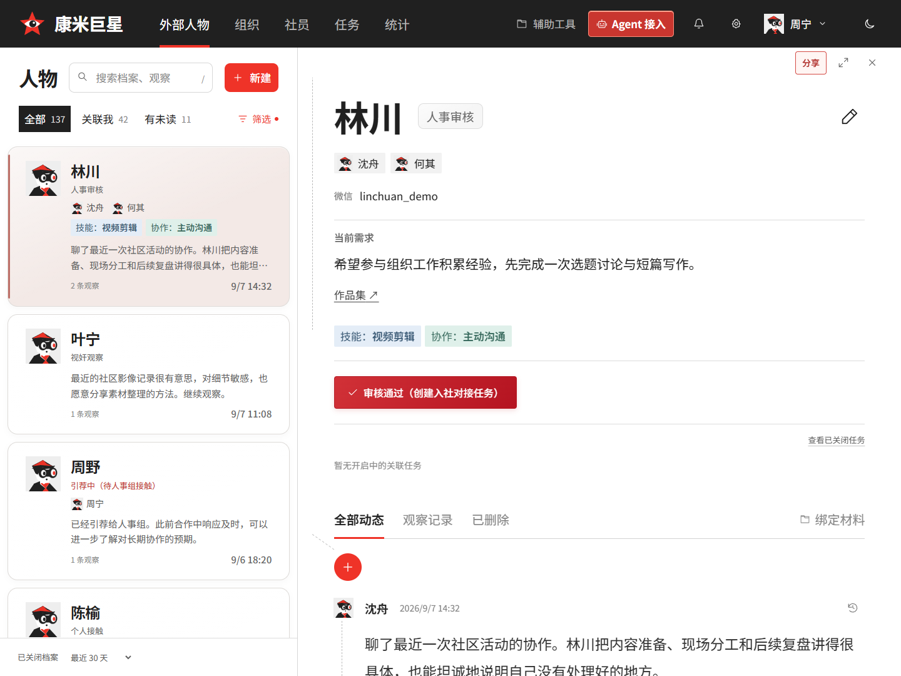
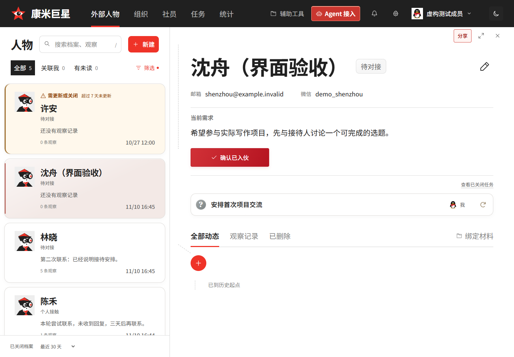
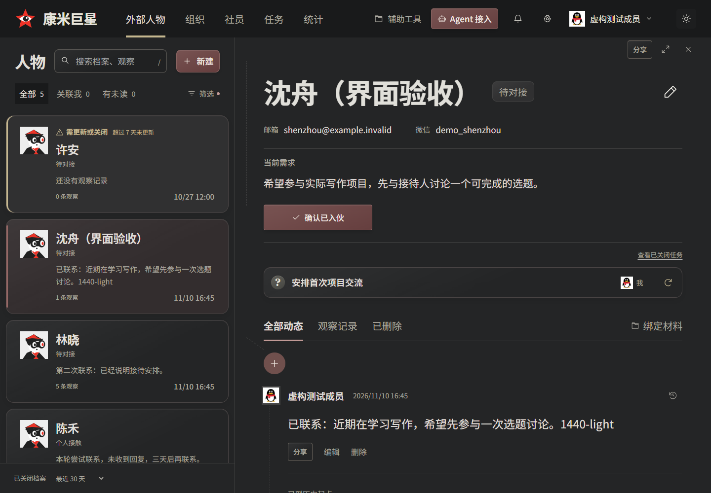
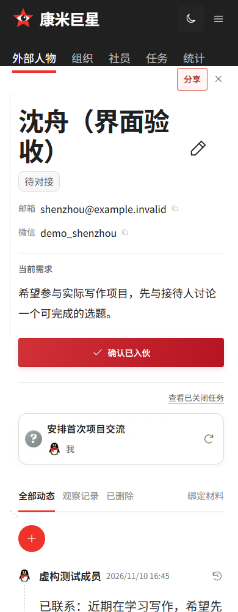
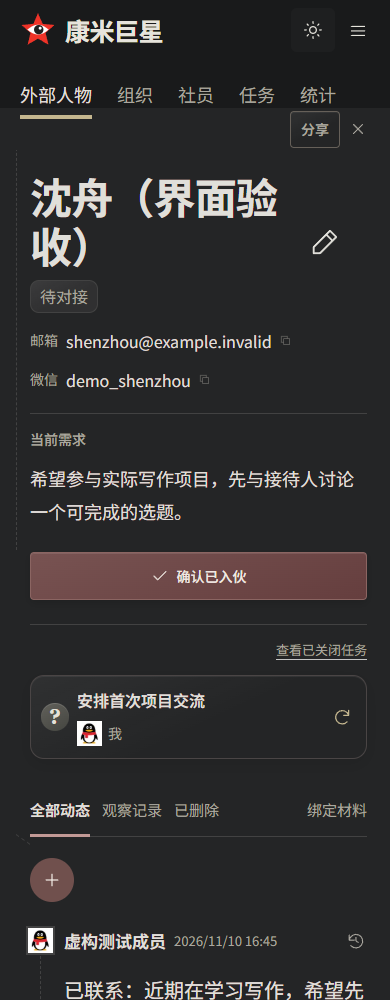
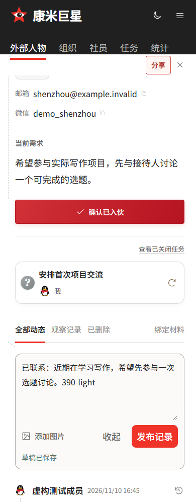

# 档案详情层级与按需观察输入（#141）

按用户截图，仅增强联系方式下方的右侧内容，维持左侧列表、人物名称及两栏结构。日夜复用同一排版。

| 内容 | 桌面 | 手机 |
| --- | --- | --- |
| 当前需求正文 | 21px | 18px |
| 详情标签 | 17px | 15px |
| 关联任务标题 | 18px | 16px |
| 观察正文 | 23px | 20px |

时间等辅助文字保持较小，需求标题低于正文层级。仅通过字号、字重与行距增强阅读，不增加容器或说明。

共享 `ComposerFrame` 的空白态只显示加号，点击或 Enter / Space 激活后展开并聚焦输入区。收起保留文字和图片，焦点返回加号；已保存草稿在刷新后自动展开，发布成功后回到加号。正式页和预览使用同一组件，草稿与提交接口沿用现有实现。

## 验证

- 类型检查、构建及 40 项 DOM 回归通过。
- `check-ui.mjs`：1920 / 1440 / 1024 / 390px 历史原型对照。仅为批准放大的正文与继承行距更新对照目标，其他几何保持原验证；正式页与当前共享原型同步。完整编辑、发布、手机、标签与头像检查通过。
- `verify-work-overview.mjs` / `verify-display-modes.mjs`：隔离真实 HTTP 与 SQLite，在1440 / 390px、日间 / 深夜检查无常驻输入框、点击及键盘焦点、收起保留、刷新恢复、真实发布和发布后折叠。需求与任务字号检查、日夜几何一致及无横向溢出通过。
- 原有浏览器业务脚本改为先激活加号再输入，保留其发布、上传和草稿断言。生产不写测试业务数据。

## 截图

| 日间 | 深夜 |
| --- | --- |
|  |  |
|  |  |

