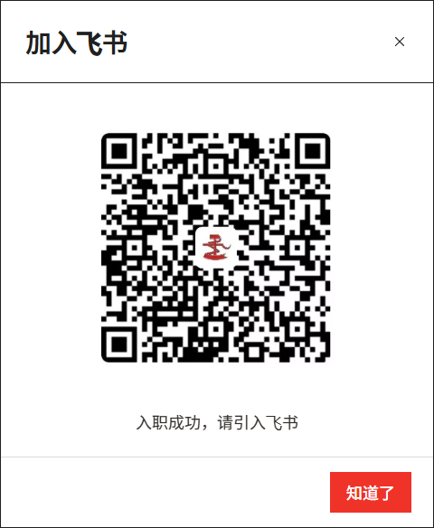
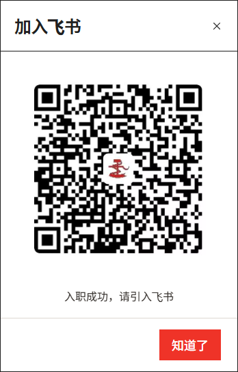
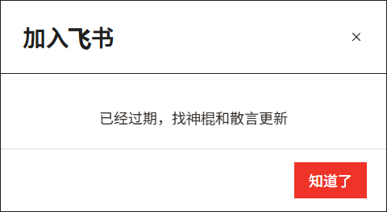
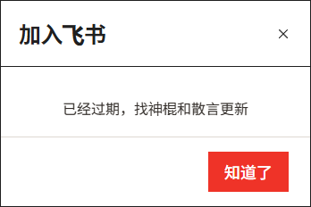

# 成为社员后的飞书邀请（#135）

实际入社状态提交成功后弹出邀请；审核通过待对接不弹。任务交付及档案状态推进均采用服务端事务返回的 `membership_joined`，同一命令回执保留结果，客户端按命令去重。刷新页面不会重弹。

用户原图按原始字节保存于 `public/art/feishu-invitation-2026-12-20.jpeg`。SVG 仅限定显示区域，未重新生成二维码。SHA-256：`5631f143c3bcd86052c1f73c2e844fb6465cbaa85a343d996f85a030f6993925`。临时二维码解码器验证了原图与桌面、手机实际渲染截图，三者目标完全一致；未新增生产依赖。

按用户“12月20号后”的要求，有效期截止为北京时间 2026-12-21 00:00；临界点后隐藏二维码并显示“已经过期，找神棍和散言更新”。打开中的窗口到期也切换。配置位于 `app/shared/feishu-invitation.ts`，收到新码后同时替换图片、显示区域及真实到期时间，不能只延长旧码日期。图片不可用时显示联系更新提示。

## 验证

- 类型检查；到期边界、真实状态转换、回执重放、成员普通维护及人事交付服务测试。
- DOM：未入社不弹、实际转换弹出、跨到期隐藏旧码、重复命令不重弹。
- `verify-feishu-invitation.mjs`（纳入 `verify-work-overview.mjs`）：隔离 SQLite 和真实 HTTP Worker，1440/390px 完整人事审核与入社交付。已知失败不弹；已提交但响应丢失，从命令回执恢复弹窗；验证数据库已转社员、二维码加载、到期隐藏、关闭及刷新不重弹。
- 正式站与 `?feishu-invitation` 原型引用同一组件；继续执行历史原型对照。所有业务写入仅发生在隔离验收数据中。

## 截图

桌面：

手机：

到期：

