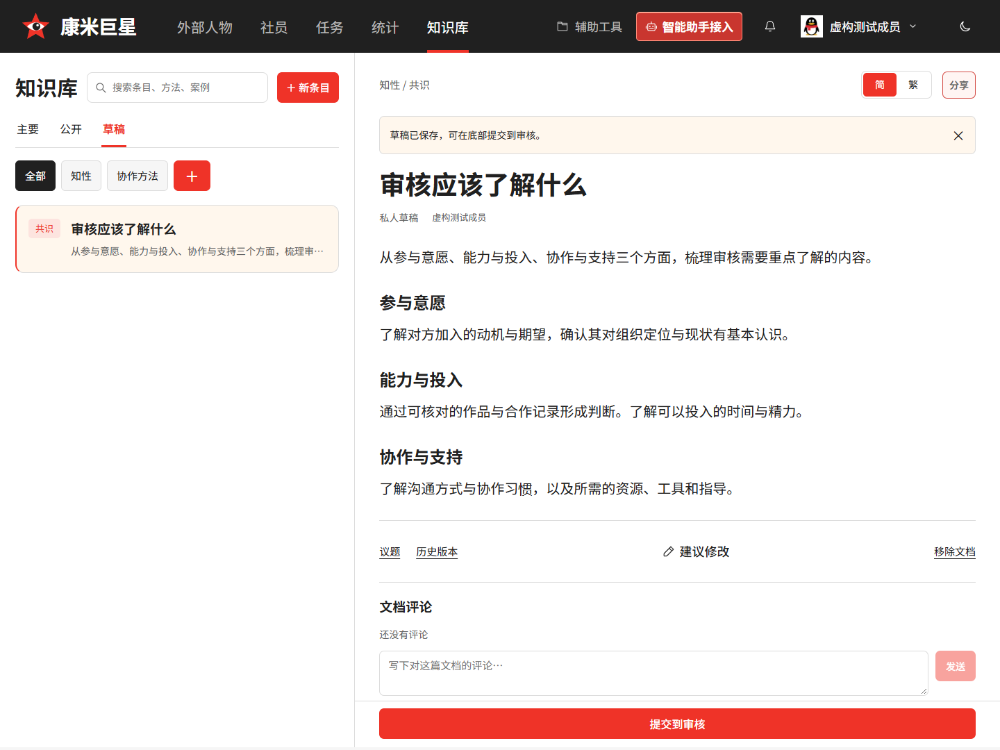
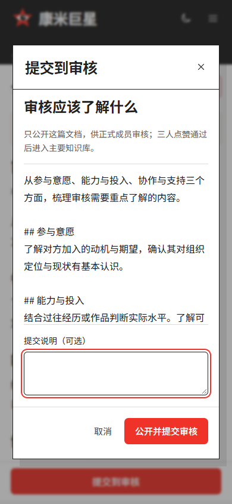
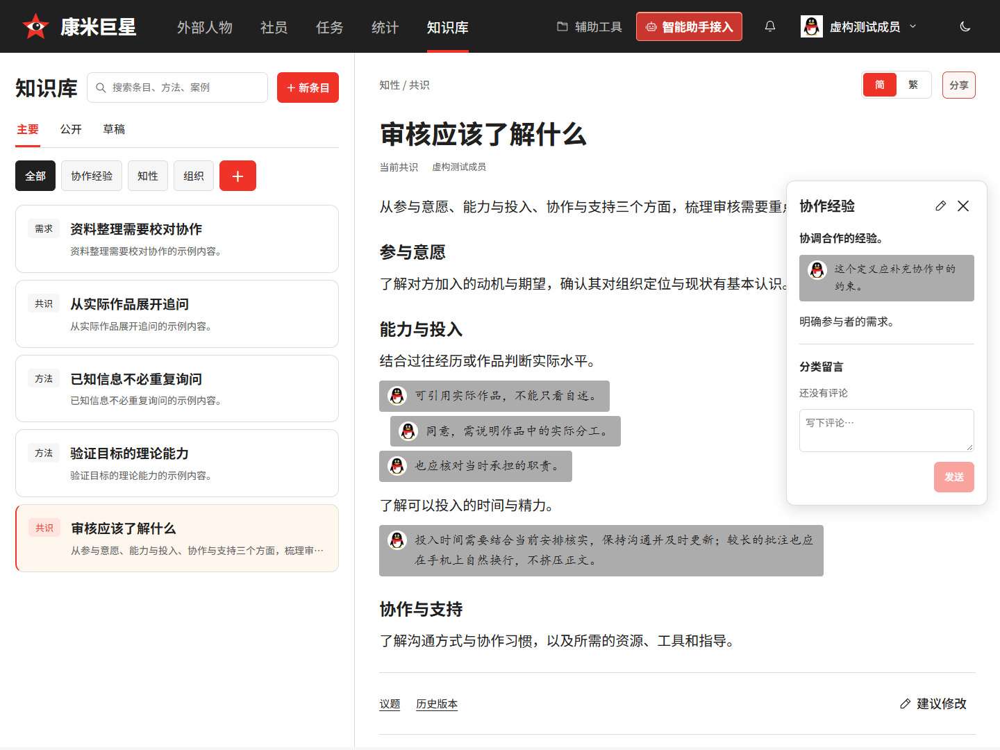

# 知识库工作台验收（#145）

2026-11-13。本轮已实现简／繁共享界面、可自建分类、临时定义与留言侧栏、文末评论、句下批注、分支与不可变历史、独立议题、三名正式成员同意及多候选选择。规则见 [知识库工作台](../knowledge-workspace.md) 和 [ADR 0021](../adr/0021-knowledge-branches-and-consensus.md)。本文替代上一轮验收中“界面待实现”的状态；旧七天期限及先到者淘汰规则不再对外使用。

## 验证结果

2026-11-13 提交与分类解耦：主站 **243** 项、知识库 **42** 项服务测试及 **40** 项 DOM 测试通过。新增服务验收覆盖单篇公开不带出其他私人稿、草稿列表推进、重复提交、第三人点赞原子合入、并行候选、改稿失效及并发第三票；分类独立新建、空分类保留、改名、不可变解释、过期引用、来源议题与私人批注隔离通过。

真实双库 HTTP 界面验收覆盖桌面／390px 底部整行提交按钮、单篇核对页、公开候审点赞、主要库更新；分类表单仅含名称与解释，解释批注可发起议题，刷新与解释改写后仍保留来源。桌面／手机完整表单、批注与日夜界面截图保存在 `tmp/verification/knowledge-workspace/`，浏览器错误为零。迁移清单及独立 Worker dry-run 通过。部署先发布兼容后端，再发布使用新入口的页面。

2026-11-13 批注后续验收：类型检查、构建、真实双库界面验证通过。新增覆盖 40% 底色、头像与楷体、原文点击／圈选／键盘定位、滚动保留、外部点击／Esc 清除、重叠引用、右键回复、刷新与简繁切换、390px 完整编辑、长批注换行、夜间及糖果只读定位；原文内容未被加粗行为改写。历史原型四种宽度与展开表单回归通过。截图由同一脚本保存到 `tmp/verification/knowledge-workspace/annotation-*.png`，使用虚构资料。

- 主站与知识库服务测试合计 **285 项通过**，DOM 测试 **40 项通过**。主站与知识库类型检查、迁移清单及规范检查通过，独立 Worker dry-run 构建通过。
- `scripts/check-ui.mjs` 历史原型对照通过；`verify-work-overview.mjs` 的桌面／手机真实 HTTP 回归通过，包括统计、档案、资源、完整表单、观察、主题、滚动和入职提示。
- `verify-knowledge-workspace.mjs` 在两个独立 SQLite 库上运行主站 Worker 与知识 Worker，经主站真实会话代理请求。桌面、手机、共享原型、普通评论、批注、分类、单候选合并、多候选议题选择、夜间、资源发布与糖果接收全部通过，浏览器错误为零。
- 测试模拟评论提交成功但响应丢失，回执恢复后数据库仅有一条记录。验证批注插在引用句与下一句之间，正文改写后原引用留在旧版本批注中。
- 两个候选分别获得三名不同正式成员同意后保持并存；通过网页创建议题并记录选择，再执行合并，另一候选仍然开启。会议结论与议题结论表单均检查。
- 原资源工具入口在权威切换后打开独立资源库；发布资源仅写入知识库。生成糖果入口后，未登录接收者可读知识库，不能新增条目，访问人事档案返回 401；指定负责人可确认接收。
- 私人材料导入重跑不会覆盖作者修改或把文档重新挂回；已共享的历史分支不会接收新的私人导入内容。糖果接收者只能读取主分支正式发布提交，不能通过历史接口读取合入前中间稿或成员议题。

历史导航新增第六项“知识库”为用户确认的变更。手机六项同排可见；桌面中等宽度仅收紧导航间距，容纳管理员按钮。知识库按钮为同款实色红色，夜间使用主站暗红配色且不增加光泽。测试均使用虚构成员和文档，不向生产写入验收数据。

## 实际界面

## 新增提交与分类界面

## 发布边界

由主站与知识库两条既有 GitHub Actions 流程发布；各自备份、迁移、部署和检查。知识库新增迁移为兼容扩展，保留历史私人内容；主站资源权威切换核对记录与版本摘要后执行。线上完成情况以对应流程终态、生产健康接口及部署版本为准，本地验收不替代线上验证。

会议结论由操作者录入，系统核验三人门槛、候选集合、提交版本和冲突，不自动证明线下会议已经召开。尚未取得同意的初始私人参考稿不会自动进入主分支。培养实训和完整宪法不属于本轮交付。
