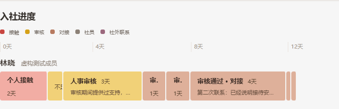
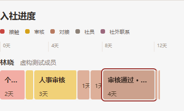
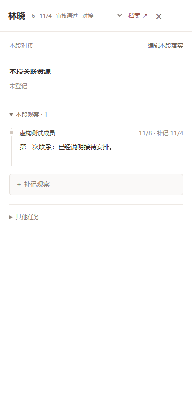

# 每条观察独立容器（Issue #131）

用户确认：每条已提交观察各占一个容器，同阶段也拆开，不增加填写步骤。

共享 `WorkOverview` 按观察和状态事件的真实时间排序。颜色仍绑定经历类型；状态变化保留边界。观察容器使用原创建事件作为稳定标识，编辑不产生新容器，删除时隐藏、恢复后保留落实关系。补记按发生时间插入；没有可核对阶段的早期记录用中性色，不猜测阶段。

原状态容器及其资源保留；新观察不继承上一格资源。白色资源仍需手工登记，来源精确到观察。新增成功后侧栏定位新记录；选择旧格只展示其对应观察。同一时刻多条记录保留可点击窄格，真实天数不改写；整行保留至少右侧八分之一留白。极短格可从侧栏经历选择器切换。

PDF 附录逐格列出时间、观察摘要与落实；JSON 版本为 1.1.0，新增 source、observation_id，无法核对阶段时 type 为 null。未改变 30 天跟进计时规则。

## 验证

- TypeScript 检查、正式构建通过。
- 20 项相关服务测试通过：同阶段、同一时刻、回滚、补记、编辑、删除恢复、资源归属、白色资源与周报。
- 39 项 DOM 回归通过。
- `scripts/check-ui.mjs` 历史原型对照通过。
- `scripts/verify-work-overview.mjs`：隔离 SQLite 数据库与真实 HTTP 接口；桌面 1440×1080、手机 390×844 的保存、刷新、资源编辑、观察补记、周报 PDF/JSON、共享原型及深夜/护眼模式通过。
- `scripts/verify-observation-containers.mjs` 纳入上述验收：同阶段两条观察分别可点击、侧栏各一条记录、新容器无旧资源、刷新保留、原型新增也独立成格。

截图使用隔离虚构档案，不涉及线上业务写入。

