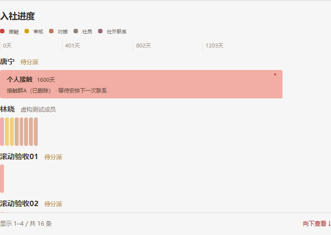
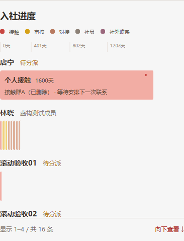
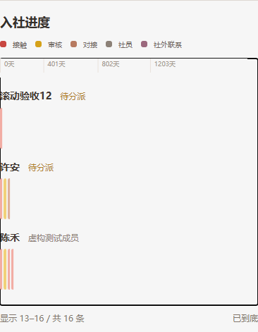

# 统计页滚动提示（Issue #133）

用户确认保留内部滚动，问题是缺少“还有其他记录”的提示。本次没有取消主表和成员明细的限高，没有改成整页展开。

共享 ScrollRegion 用于入社进度、成员明细和展开的逐期数据。仅纵向溢出时显示“显示 1–4 / 共 16 条”和“向下查看 ↓”；按钮向下滚动约四分之三屏，到底显示“已到底”。滚动、筛选、内容加载和窗口变化后重新计算可见范围。列表保留键盘操作，滚动条增加颜色与宽度；周报不显示交互提示。

## 验证

- TypeScript、正式构建及 39 项 DOM 回归通过。
- `verify-work-overview.mjs` 的桌面／手机真实 HTTP 验收通过，覆盖观察保存、资源编辑、周报、原型与显示模式。
- 新增 `verify-scroll-hints.mjs`，在隔离数据库加入多档案和多成员，检查 1440／390px 限高仍然生效、计数提示、点击向下、键盘 End、到底、筛选后隐藏、逐期表格以及侧栏编辑。
- 历史原型对照：`check-ui.mjs`。

截图均为隔离验收数据。

