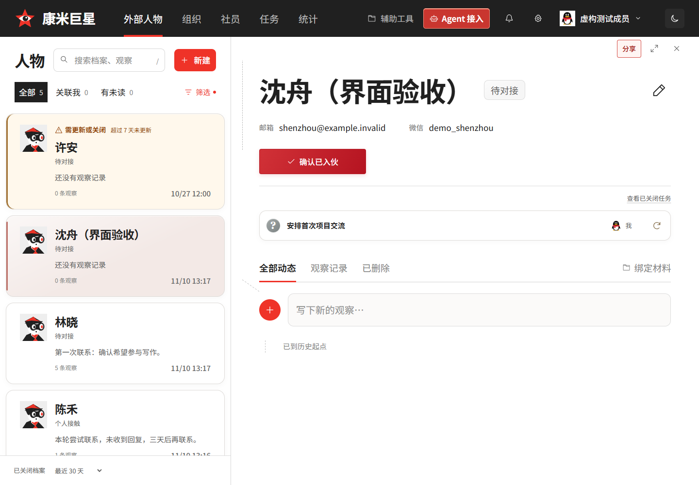
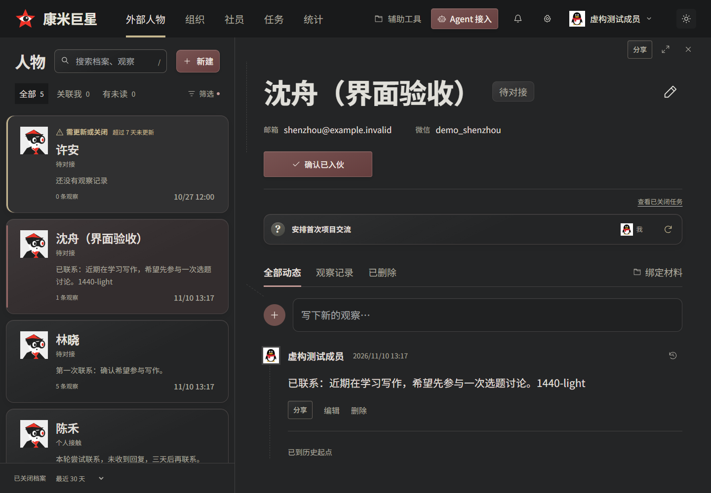
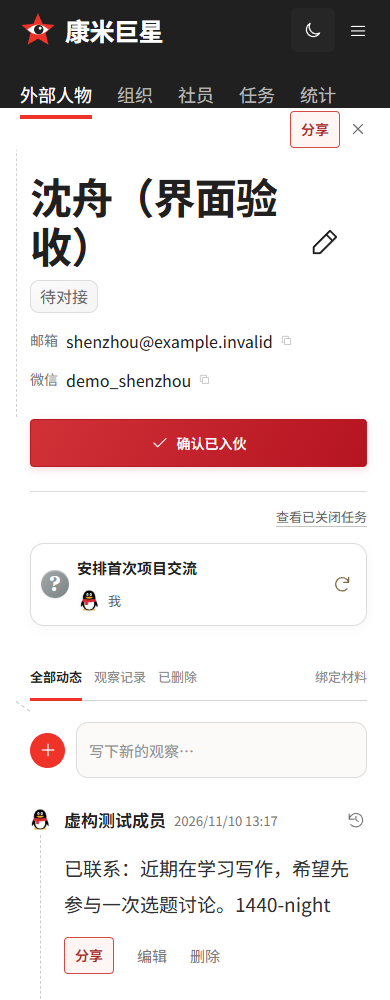
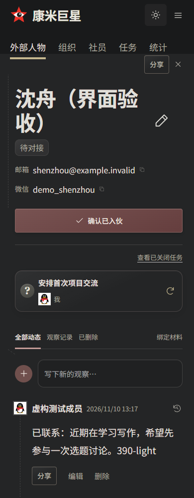

# 日夜共享布局与深夜配色（#139）

用户最终确认以选定的低饱和炭灰预览为基线，白天沿用同一布局。正式页与原型继续引用 `app/ui/`，没有另建主题页面或第二套表单。参考 Semi Design 的 [无边框按钮](https://semi.design/zh-CN/basic/button) 和 [深色模式](https://semi.design/zh-CN/advanced/dark-mode) 的语义色与表面层次，具体视觉以用户确认的预览为准。

- 档案卡片、任务分组与观察输入区采用柔和圆角、轻微内高光。夜间采用中性炭灰、暗红按钮、旧金焦点、灰白正文；浮层、完整表单、提示、菜单与图表一起适配。
- 档案类型／编号、关联任务标题和开启计数删除。编辑改为 30px 笔形图标，触控区桌面 48px、手机 44px。保留可访问名称与悬停说明。
- 常态短标签“待对接”代替长状态文案，不改真实业务状态；紧凑任务状态使用进行、等待、待提交、完成等具名图标，点入详情仍有完整信息。
- 关闭档案范围放到左侧列表底部，始终可操作；列表独立滚动，手机在列表页可见，不重复放入顶部或展开筛选。
- 日／月按钮直接切换，无护眼模式和下拉菜单。旧偏好迁移、刷新、跨标签同步、键盘及受限存储均保留。

## 验收

使用隔离 SQLite 与真实 HTTP Worker；截图中的人物、任务、观察均为虚构验收数据，不向生产档案写入测试内容。

`verify-display-modes.mjs` 纳入 `verify-work-overview.mjs`，覆盖：

- 1440px / 390px 日夜档案几何一致、底部范围切换与滚动固定、唯一编辑入口、短状态与可访问任务图标。
- 真实观察发布并回读数据库；关联任务弹窗；深夜完整档案编辑、任务交付、资源创建、重载及完整发布区域。
- 375 / 390 / 768 / 1024 / 1201 / 1280 / 1440px 顶栏无重叠和横向溢出，Enter / Space、跨标签、登录目标保留、首次绘制恢复、care 迁移、受限存储。
- 同一共享原型、统计四图、周报 PDF / JSON 与人事交付回归。

`check-ui.mjs` 继续比较 1920 / 1440 / 1024 / 390px 历史原型的未变几何；仅对批准替换的观察输入底图，将历史静态 SVG 明确调整为 `none`，同时要求正式页和当前共享原型一致。完整编辑、发布、手机、头像、图片阅读、通知回归均通过。类型检查、构建、241 项业务测试与 DOM 测试通过。

## 界面截图

| 日间 | 深夜 |
| --- | --- |
|  |  |
|  |  |

[深夜手机列表及底部筛选](screenshots/theme-icon-toggle-139/night-archive-list-390.png) · [完整档案编辑](screenshots/theme-icon-toggle-139/night-archive-editor-1440.png) · [手机发布区](screenshots/theme-icon-toggle-139/night-observation-publish-390.png) · [手机交付](screenshots/theme-icon-toggle-139/night-delivery-390.png) · [统计](screenshots/theme-icon-toggle-139/night-statistics-1440.png) · [用户批准的视觉参考](screenshots/theme-icon-toggle-139/approved-reference.png)
