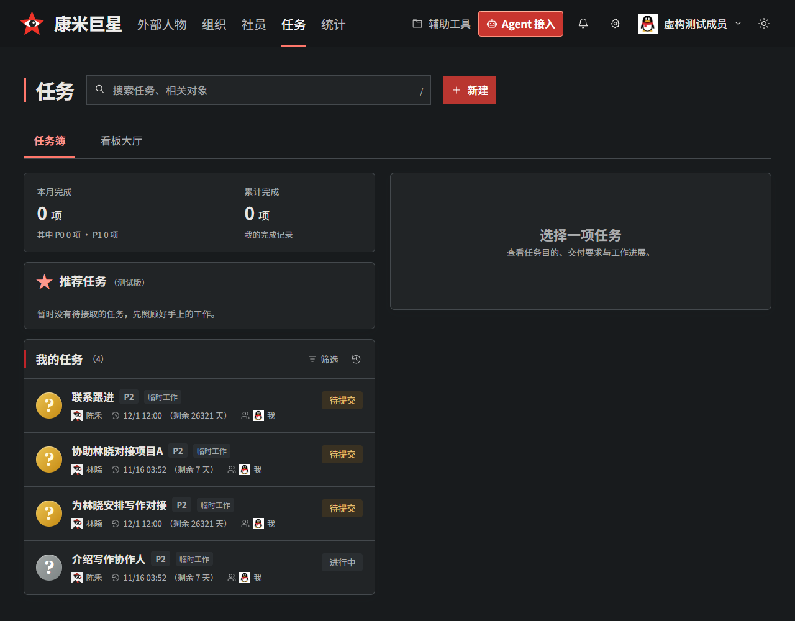
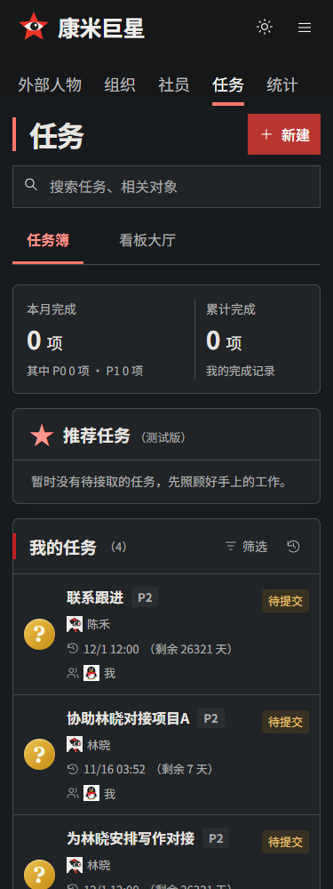

# 日月图标直接切换（#139）

用户要求删除护眼模式，日/月图标点击直接切换。参考字节跳动 Semi Design 的 [无边框按钮](https://semi.design/zh-CN/basic/button) 和 [亮暗色变量切换](https://semi.design/zh-CN/advanced/dark-mode)，将原下拉选择替换为单个紧凑按钮，复用主站图标组件与已有两套配色，未引入新的组件库。日间显示月亮，深夜显示太阳；悬停和辅助技术名称表达点击后的模式。

正式站、登录页和原型共用 ThemePicker。桌面按钮40px，手机44px，提供悬停、按下与键盘焦点反馈。旧护眼偏好在页面第一次绘制前回退日间；保留本地记忆、跨标签同步，浏览器禁止存储时仍可点击切换。

## 验证

`verify-display-modes.mjs` 通过隔离真实 HTTP/SQLite 验证桌面与手机任务、统计、完整交付/档案/资源表单、保存和刷新，375/390/768/1024/1201/1280/1440px 顶栏无重叠溢出。覆盖 Enter/Space、跨标签同步、登录后目标保留、首次绘制前恢复、旧护眼偏好迁移和受限存储；无模式选择菜单。纳入 `verify-work-overview.mjs`，另运行 `check-ui.mjs` 历史原型对照。

## 截图

